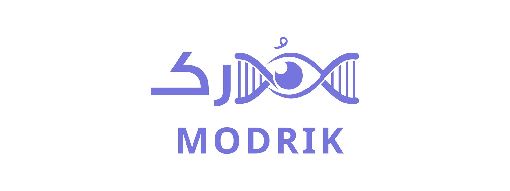
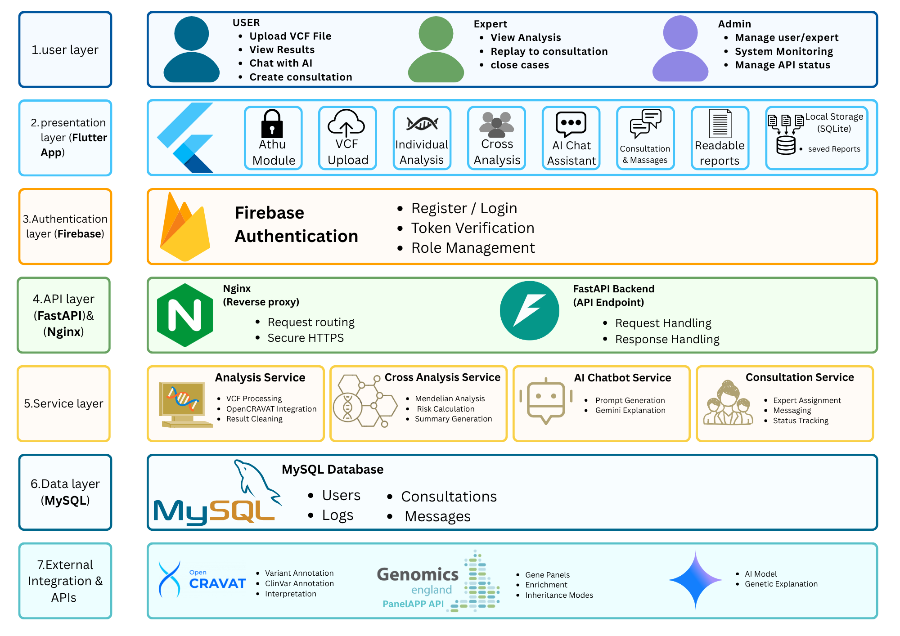
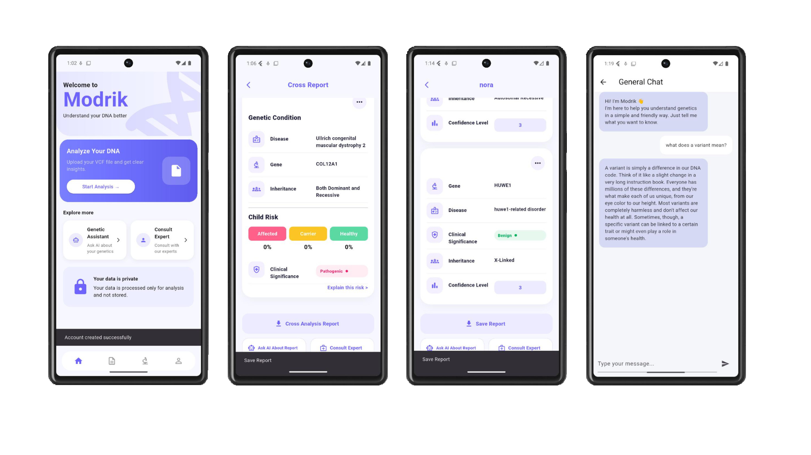
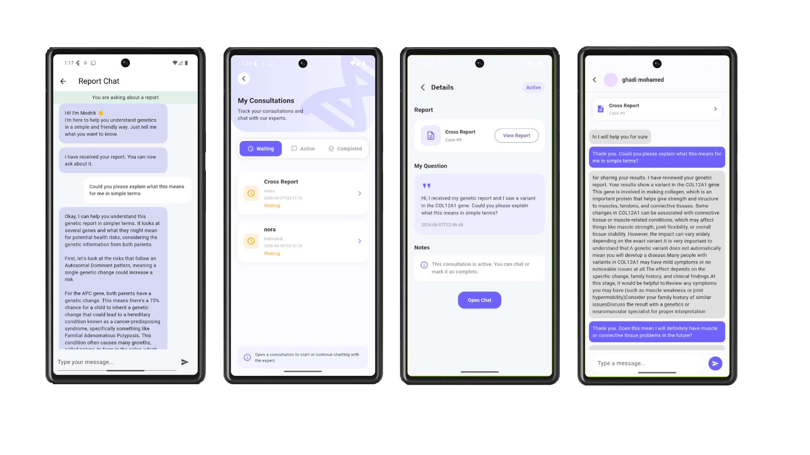

<p align="center">
  <picture>
    <source media="(prefers-color-scheme: dark)" srcset="assets/modrik_banner_dark.jpg">
    
  </picture>
</p>

<h3 align="center">Understand Your DNA, in Simple Words</h3>

<p align="center">
  
  
  
  
  
  
  
  
  
</p>

Modrik (مُدرك) is a cross-platform mobile app that turns a genetic test file (VCF) into clear, easy findings: which variants were found, which diseases they are linked to, and what they may mean for the user or their future children.

It was built as our **Computer Science graduation project at Umm Al-Qura University** (2026). I worked on the **mobile app and the backend** (full-stack development).

## The Problem

- Genetic test results come as **VCF files**, which are very hard to read without a bioinformatics background.
- Analysing them usually needs **several separate tools**, each with its own format.
- People who get their results often have **no simple way to ask an expert** what the findings mean.

## Features

**Genetic analysis**
- **Individual analysis:** upload one VCF file and get annotated variants with their genes, linked diseases and clinical significance
- **Couple analysis:** upload two VCF files and see the inheritance pattern and the child's risk (affected, carrier or healthy)
- **Disease names in Arabic and English**, with a short explanation of each condition

**Help in understanding the results**
- **AI assistant** that explains a report in simple words, plus a general genetics chat
- **Expert consultation:** send a report to a genetics expert and chat with them inside the app
- **Push notifications** when an expert accepts a request

**Privacy and accounts**
- **Reports are saved only on the user's phone** (SQLite), not on the server
- **Three roles:** user, expert and admin, each with their own screens
- **Admin dashboard** with numbers on users, analyses and experts
- **Arabic and English** interface

> The AI assistant does not take part in the genetic analysis. It only helps explain findings that come from the bioinformatics pipeline.

## How It Works

1. The user uploads a VCF file (or two for a couple analysis) from the app.
2. The FastAPI backend runs **OpenCRAVAT** to annotate every variant.
3. The results are cleaned, and the affected genes are matched with diseases using **PanelApp**.
4. For couples, a **Mendelian analysis** compares both files to estimate the child's risk.
5. The app shows the report in simple cards and saves it on the phone.
6. The user can ask the AI assistant about the report, or open a consultation with an expert.

<p align="center">
  
</p>

## Screenshots

<p align="center">
  
</p>

<p align="center">
  
</p>

## Project Structure

```
Modrik/
├─ frontend/Modrik/          Flutter mobile app
│  └─ lib/
│     ├─ screens/            App screens
│     │  ├─ users/           Upload, reports, AI chat, consultations
│     │  ├─ expert/          Expert requests and chat
│     │  ├─ admin/           Admin dashboard
│     │  └─ shared/          Login, sign up, profile, chat
│     ├─ services/           Calls to the backend API
│     ├─ widgets/            Reusable UI parts
│     ├─ models/             Report data models
│     ├─ l10n/               Arabic and English text
│     └─ theme/              Colours and text styles
├─ backend/                  FastAPI server
│  ├─ main.py                API endpoints
│  ├─ database.py            MySQL connection
│  ├─ services/              OpenCRAVAT, PanelApp, couple analysis, AI, consultations
│  ├─ utils/                 Data cleaning helpers
│  ├─ requirements.txt
│  └─ .env.example           Settings template (copy to .env)
├─ assets/                   README images
└─ README.md
```

## Team

Developed by the **Modrik Team** as a Computer Science graduation project at Umm Al-Qura University.

[Ghadi Alrashdi](https://github.com/Ghadi213) · Hagar Naga · [Rudaynah Alghubishy](https://github.com/itsrudaynah) · Majd Alharbi

## Acknowledgments

- [OpenCRAVAT](https://opencravat.org) for variant annotation
- [PanelApp](https://panelapp.genomicsengland.co.uk) for gene and disease data
- Google Gemini API for the AI assistant
- OpenRouter API for Arabic translation of disease names
- Firebase for authentication and notifications

## Copyright

© 2026 Modrik Team. This repository is shared for academic and portfolio purposes only. The code may not be redistributed or used commercially without permission from the project authors.
